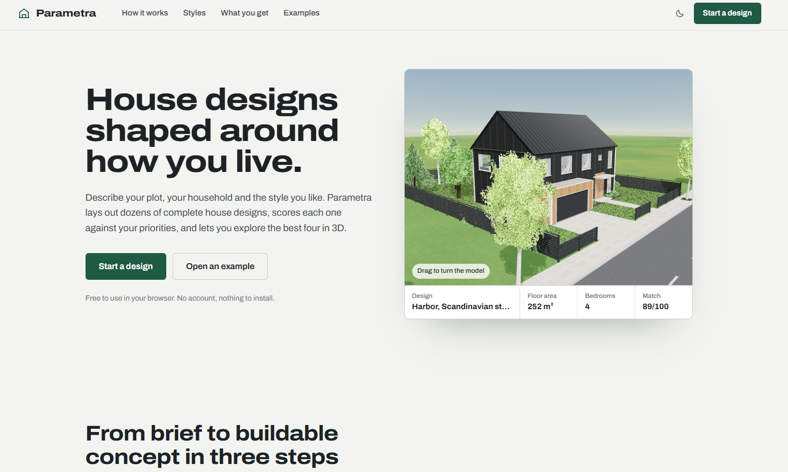
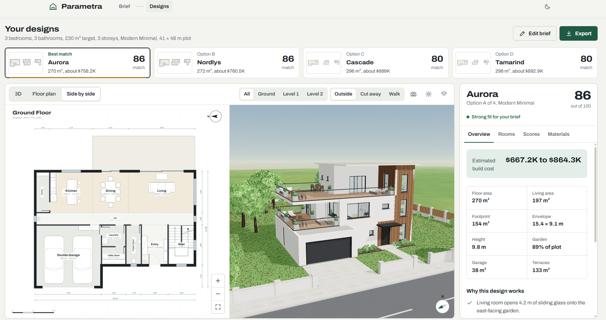

# Parametra





House designs shaped around how you live. Describe a plot, a household and a style, and Parametra lays out dozens of complete house designs, scores each one against your priorities, and lets you explore the best four as dimensioned floor plans and as a furnished 3D model.

It is a fully static site: plain HTML, CSS and ES modules. There is no build step, no backend and no runtime CDN for code (Three.js is vendored). It works on GitHub Pages or any static host.

## Run locally

ES modules must be served over http. Opening `index.html` straight from disk won't work.

- **Windows:** double-click `start.bat`. It opens [http://localhost:8080](http://localhost:8080).
- **Any OS:** run `python -m http.server 8080` in this folder, then open [http://localhost:8080](http://localhost:8080).

## Deploy to GitHub Pages

1. Push this folder to a repository.
2. In **Settings → Pages**, set the source to **Deploy from a branch**, then pick your branch and `/ (root)`.
3. The site goes live at `https://<user>.github.io/<repo>/`. All paths are relative and routing uses the URL hash (`#/brief`, `#/studio`), so no server rewrites are needed. `.nojekyll` stops Jekyll from processing the files.

The only external request on page load is Google Fonts (Archivo). If the fonts are blocked, the site falls back to system fonts. The optional map in the brief's first step loads more, only when it is opened (see [Real lots on a map](#real-lots-on-a-map)).

## How it's organised

| View                            | What it does                                                                                                                                                                                 |
| ------------------------------- | -------------------------------------------------------------------------------------------------------------------------------------------------------------------------------------------- |
| **Landing** (`#/`)      | Live 3D turntable of a sample design, how it works, the eight styles drawn as elevations, a real plan output, and six example briefs                                                         |
| **Brief** (`#/brief`)   | Six guided steps: plot, size, rooms, kitchen and outdoors, style, priorities. A live preview of the best layout updates as you choose                                                        |
| **Studio** (`#/studio`) | Four recommended designs as tabs. A single viewer switches between 3D, floor plan and side by side. A details panel has Overview, Rooms, Scores and Materials tabs. Export lives in one menu |

**3D viewer modes:**

- Outside: orbit the house.
- Cut away: a section plane at each level, with dark fill where walls are cut.
- Walk: first-person walkthrough.

It also has a sun-position slider tied to the plot's orientation and hemisphere, camera presets, and layer toggles.

**Landscaping:**

- **Lawn:** a shader adds large-scale colour variation and hides texture tiling, with instanced 3D grass tufts on top.
- **Trees:** branching trunks with bark textures and leaf-card crowns that cast dappled shadows. Species follow the style: birch, oak, maple, olive, cypress, pine, palm.
- **Planting:** shrubs, ornamental grasses and mulched beds.
- **Boundaries by style:**
  - board-formed concrete wall with timber battens
  - rendered wall with a timber slat screen
  - timber board fence
  - stucco or brick walls with coping and piers
  - picket and post-and-rail fences
  - stone walls

**Exports:**

- **IFC4 BIM model:** written from the live 3D scene, so it matches the 3D view.
  - Geometry: every object is exported as tessellated geometry (`IfcTriangulatedFaceSet`), including walls, openings, doors, windows, slabs, the roof, stairs, railings, furniture, sanitaryware, paving, boundary walls, fences, trees and planting.
  - Appearance: each material becomes an `IfcSurfaceStyle` and an `IfcMaterial` with its colour, transparency and finish. Its texture is embedded as an `IfcBlobTexture` with UV coordinates. Viewers that ignore textures still show the right colours.
  - BIM structure: proper IFC classes (`IfcWall`, `IfcRoof`, `IfcStair`, `IfcFurniture`, `IfcSanitaryTerminal`, `IfcGeographicElement`…). Doors and windows void and fill their host walls, and furniture sits in its room's `IfcSpace`. It includes property sets, base quantities and true north.
  - Left out: the instanced grass tufts. The lawn surface keeps its texture. The ground and street are clipped to the plot plus a margin.
  - It passes ifcopenshell schema and rule validation.
- **GLB** 3D scene.
- **SVG** plans for every level.
- **PNG** image of the 3D view.
- **JSON** design data.

Deep links: `?preset=villa#/studio`, `?style=japandi#/brief`, `?step=3#/brief`, `?view=plan#/studio`, `?tab=rules#/studio`, `?theme=dark`.

## How designs are generated (`js/engine.js`)

1. **Program.** The brief becomes rooms with preferred areas and width limits. Suites are grouped: master with walk-in and ensuite, kitchen with pantry, laundry with store.
2. **Envelope.** The planning rules become hard caps before anything is laid out: buildable width and depth from the setbacks, maximum footprint from site coverage, maximum floor area from the floor area ratio.
3. **Floors.** Public rooms go on the ground floor and bedrooms upstairs, with a bathroom on every bedroom floor. Flexible rooms then move between floors whenever that narrows the footprint.
4. **Banded layout.** Each storey has a street band, a 1.2 m circulation spine and a garden band. Bands get shallower to fit the buildable depth. Free rooms are split between the bands by an exact branch and bound that minimises the longer band. Room widths along each band are solved exactly as a small quadratic program (see below), and are squeezed towards their minimums, never below, when the envelope is capped. Spare length becomes storage or a roof terrace. The U-stair lines up on every level.
5. **Derivation.** Walls come from classifying the edges between rooms as exterior, interior or open plan. Doors follow a parent graph. Windows follow style glazing ratios, room type and privacy settings. Furniture is placed per room with collision checks.
6. **Rule check.** Every layout is checked against 14 rules (below). A layout that breaks any of them is rejected, not scored lower.
7. **Scoring.** Nine criteria are weighted by your priority sliders: efficiency, proportions, daylight, solar orientation, functional flow, privacy, area match, site fit and build economy. The four best distinct compliant designs are shown.

### How many alternatives

The search is adaptive (`search()` in `js/engine.js`):

- **Stage 1**, every brief: band depths × stair position × mirror × kitchen side, 36 to 108 variants.
- **Stage 2**, when stage 1 gives fewer than two compliant designs: compact variants, with every room at its smallest, over a wider range of band depths; and, with a garage, a narrow-lot layout with the garage in front of the service rooms instead of beside them, which saves up to 6.4 m of width. That is up to about 700 more variants. Stage 2 is skipped when every layout fails a rule only the brief can change (storeys, ceiling height, parking).
- **Adjusted designs**: if nothing passes, the fix search (in the worker) also generates the designs for its two best tested changes. They lead the options, labelled "Adjusted: …", followed by the closest design as briefed, and one click makes the change part of the brief.

Measured on 300 random briefs across the whole option space: 142 got four or more designs as briefed, and 102 more got buildable adjusted designs, so 81% in all, up from 43% before. The other 19% are mostly very large programs on small plots, and plots with less than about 9 to 10 m of buildable width. The banded layout needs living, dining and kitchen side by side, about 9.6 m at minimum sizes, so those need a narrow-lot layout type that is not built yet.

### Planning rules (`js/rules.js`)

| Group              | Rule                                                                                                                       |
| ------------------ | -------------------------------------------------------------------------------------------------------------------------- |
| Planning           | Side setbacks, front and rear setbacks, site coverage, floor area ratio, building height, storeys, planted ground, parking |
| Building standards | Ceiling height, minimum room sizes, daylight, stair geometry, corridor width, a door into every room                       |

The brief's first step has three starting profiles (Suburban, Urban infill, Rural) with typical values. They are not any one city's code, and every value can be edited. Height is measured to the parapet on flat roofs and to the mid-point of the roof slope on pitched roofs. Daylight treats rooms that are open to each other as one space, and kitchens may use artificial light.

**When nothing fits.** If no layout passes, the studio shows the closest designs, marked with the rules they break, and explains:

- which rules no layout met, and the closest any layout came ("14.3 m wide, 11.0 m available");
- what plot would pass, where the plot decides ("needs a plot at least 17.3 m wide");
- changes to the brief that make it fit, such as "Leave out the garage". Each one is proved by regenerating the layouts and finding one that passes every rule. Single changes are tried first, cheapest first, then a beam search over up to four changes. The search runs in a Web Worker (`js/fixworker.js`), so the page stays responsive.

### Real lots on a map

The Plot step has two modes. **Enter dimensions** (the default) works as before. **Find it on a map** is optional:

1. Search an address, or skip the search and pan the map yourself.
2. Press **Draw lot**, click each corner, then close the shape (click the first corner, double-click, or press Finish). Drag corners to adjust it.
3. Parametra reads the lot area, frontage, depth, street bearing and hemisphere from the drawing. It finds the street side from the nearest OpenStreetMap road outside an edge. Click any edge to change it.

How the drawn lot is used (`js/lot.js`):

- The corners are projected to local metres and rotated so the street edge runs along the bottom.
- Setbacks apply per edge: front for the street edge, rear for edges facing the back, side for the rest.
- The buildable area is computed on a grid of 10 cm or finer. A cell counts only if all of it keeps every setback, so fits are never overstated, by up to about 0.2 m.
- A largest-rectangle sweep finds the widest street-aligned footprint at every depth. That caps the generator, and the house goes where it fits nearest the street, centred on the frontage. This works for concave lots too.
- The planning rules swap the two rectangle setback checks for one **Setbacks** check: the footprint, garage included, must fit inside the lot. Site coverage, floor area ratio and planted ground use the true lot area. The patio and pool shrink, or are left out, to stay inside the boundary.
- The 3D view builds fences or walls along every lot edge, angled ones included. Trees, shrubs and grass stay inside the lot. The Overview tab shows a site plan.
- **Real surroundings in 3D** (`js/surroundings.js`): around a drawn lot, the 3D view lays satellite imagery of the real place on the ground, about 130 to 220 m around the lot. It is the same imagery the lot was drawn on, placed through the lot's own coordinate frame, so the two line up. The plot itself shows the new design (lawn, boundary, planting) in place of what stands there today. The made-up street is left out, since the real street is in the imagery. When OpenStreetMap's Overpass service answers, neighbouring buildings appear as plain massing blocks, with heights from their tags or typical values; when it is busy, the imagery shows alone. The sun and compass use the lot's exact street bearing, so shadows match the photo. A credit line shows in the 3D view, and **Layers → Real surroundings in 3D** switches it off. Imagery and neighbours are third-party data and are not included in the IFC or GLB exports.

Services the map uses, only once it is opened: map imagery from Esri World Imagery and OpenStreetMap tiles; address search and street detection from OpenStreetMap Nominatim, with the Overpass API as a fallback for street detection. Leaflet 1.9.4 is vendored in `vendor/leaflet/` and loaded on first use. The drawn lot, including its coordinates and address, is saved only in the browser's local storage and in exports the user makes. Check each provider's usage terms before heavy or commercial use; for that, a keyed imagery provider is the usual choice.

Limitations: the house is still a street-aligned rectangle with a garage, so wedge-shaped or very irregular lots leave some buildable area unused. Sun studies use the nearest compass direction to the real street bearing. Drawing on the map needs a mouse or touch; typing the dimensions works from the keyboard.

### Exact solvers (`js/solver.js`)

No solver library is needed, so the site stays static with no runtime dependencies:

- **Room widths:** minimise Σ (wᵢ − pᵢ)² / fᵢ subject to Σ wᵢ = L and loᵢ ≤ wᵢ ≤ hiᵢ, where p is the preferred width and f the flexibility. The KKT conditions give wᵢ(λ) = clamp(pᵢ + λfᵢ, loᵢ, hiᵢ), and Σ wᵢ(λ) is piecewise linear, so the optimum is found exactly by walking its breakpoints. If Σ lo > L the band cannot fit, and the shortfall is exact.
- **Band assignment:** branch and bound over every split of the free rooms, minimising the longer band, then the total.

Both were checked against brute force on thousands of random cases.

## Files

```text
index.html            app shell, icon sprite, import map → vendor/three
css/app.css           design tokens (light + dark), layout, components
js/main.js            router, landing page, brief wizard, studio, exports
js/data.js            room catalogue, styles, rule profiles, room minimums, defaults
js/engine.js          layout generator, walls/openings, scoring, recommender, fix search
js/rules.js           planning rules: envelope caps, compliance check, diagnosis, fixes
js/lot.js             drawn lots: projection, street frame, buildable grid, largest-rectangle fit
js/sitemap.js         the optional map: Leaflet, address search, drawing, street detection
js/surroundings.js    satellite imagery and neighbouring buildings for the 3D view of a drawn lot
js/solver.js          exact band-width QP and band-assignment branch and bound
js/fixworker.js       runs the fix search off the main thread
js/furniture.js       furniture layout solver
js/plan2d.js          SVG floor plans and thumbnails
js/viewer3d.js        Three.js scene: building, roofs, stairs, site, modes, GLB
js/landscape.js       lawn shader, grass, trees, shrubs, hedges, boundaries
js/models3d.js        furniture models
js/textures.js        procedural textures and leaf cards (no image assets)
js/ifc.js             IFC4 STEP exporter
vendor/three/         Three.js r169 (MIT) and the addons used
vendor/leaflet/       Leaflet 1.9.4 (BSD-2-Clause), loaded only with the map
start.bat             local launcher for Windows
```

## Notes

- Designs are concept-stage studies for briefing an architect. They are not construction documents, and costs are indicative (USD).
- The 3D view needs WebGL. Floor plans and every other part of the site work without it.
